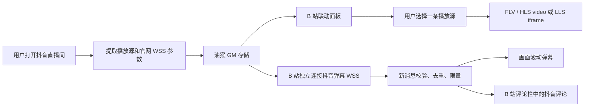

# 抖音直播联动脚本逻辑说明

本文说明仓库唯一安装入口 [`douyin-live-2.0.user.js`](./douyin-live-2.0.user.js) 的实现。版本统一为 **2.0**，标题、中文描述和英文描述沿用脚本元数据。旧版可以从 Git 提交历史查看，不再同时提供多个安装文件。

本文记录的是代码行为，不把注释中的目标或短时实测结果当作平台永久保证；第三方播放器内核的内部实现不属于本脚本维护范围。

## 1. 整体结构和运行入口

脚本采用单文件 IIFE，在 `document-start` 启动，使用严格模式。处理顺序如下：

1. `@noframes` 与 `window.self !== window.top` 双重排除子框架，避免同一页面注册多份菜单和面板。
2. 根据域名区分 B 站和抖音。B 站仅接受数字直播间路径 `/房间号`、`/blanc/房间号`；首页、分类页直接退出。
3. 定义消息协议、URL、分辨率、错误说明和后台保护等公共函数。
4. 抖音页负责获取播放源、捕获官网弹幕连接参数、旁听普通评论、发布心跳和执行刷新请求。
5. B 站页负责联动面板、独立弹幕连接、视频播放、分屏、统计和恢复。

`whenDocumentReady` 同时兼容正在加载和已经完成加载的文档，避免错过 `DOMContentLoaded`。关闭面板只隐藏面板，不停止已经启动的播放、弹幕和恢复逻辑。



## 2. 依赖与权限

| 依赖 | 当前固定版本或构建 | 用途 |
| --- | --- | --- |
| mpegts.js | `1.8.2`，`dist/mpegts.min.js` | FLV 解封装和播放 |
| hls.js | `1.7.2`，`dist/hls.min.js` | HLS 播放；支持时使用 MSE |
| 抖音网页播放器 | `new-player-merged.91d4e3c1.js` | 在 LLS iframe 内使用 `sdk.Protocol.RTM` |
| 油猴 GM API | 存储、变更监听、样式、菜单 | 跨站交换数据、持久化用户开关 |
| `unsafeWindow` | 页面上下文 | 旁听官网 WebSocket、访问 B 站已有播放器实例 |
| 浏览器 API | WebSocket、gzip 解压、Web Animations、WebRTC 统计等 | 弹幕协议、动画和状态采集 |

两个 `@require` 文件由 jsDelivr 加载；LLS SDK 从字节静态资源域加载。没有自动追随最新版的逻辑，也没有把依赖打包进本文件。依赖加载失败、CSP、网络限制或浏览器缺少所需能力，都会影响对应功能。

LLS 是此脚本接入的 RTM/SDP 播放路径，不等同于 LL-HLS；HLS 的 `lowLatencyMode: true` 也不会把普通 HLS 地址变为 LLS。

## 3. 数据模型与存储

### 3.1 跨标签页的 GM 数据

| 键 | 写入方 / 读取方 | 内容和含义 |
| --- | --- | --- |
| `BILI_ROOM_URL` | B 站面板 / B 站页 | 目标 B 站直播间；默认 `https://live.bilibili.com/545318` |
| `DY_ROOM_URL` | B 站面板 / B 站页 | 目标抖音直播间；默认 `https://live.douyin.com/200525029536` |
| `DY_STREAM_MAP` | 抖音 / B 站 | 按抖音房间号保存 `{roomId,time,streams}` |
| `DY_HEARTBEATS_MAP` | 抖音 / B 站 | 每个房间最近的页面心跳时间 |
| `DY_FORCE_EXTRACT` | B 站 / 抖音 | 用时间戳请求现有抖音页立即重新提取源 |
| `DY_REFRESH_REQUEST` | B 站 / 抖音 | `{roomId,at,reason}`，请求已有抖音页刷新 |
| `DY_CHAT_CONNECTION` | 抖音 / B 站 | `{roomId,url,capturedAt}`，官网 WSS 连接参数 |
| `DY_DANMAKU_BATCH` | 抖音 / B 站 | 最新一批普通评论：房间、来源、时间、会话、序号、items；不是历史消息库 |
| `SHOW_SOURCE_LABELS` | B 站面板 / B 站页 | “显示来源”，未设置时为 `false` |
| `SHOW_DOUYIN_DANMAKU` | B 站面板 / B 站页 | “显示抖音弹幕”，未设置时为 `false` |
| `AUTO_RECOVER_ENABLED` | B 站面板 / 两站 | “断流自动恢复”，未设置时关闭；保留已保存的用户选择 |

除已注册的变更监听外，B 站还有 800 ms 的批次补读，补偿漏掉的通知。重复通知由批次与消息两级去重拦截。开关会保留上次选择；“默认关闭”不代表强制覆盖已有保存值。

### 3.2 页内状态和会话状态

- `currentStream` 保存用户实际选择的源；`streamPlayer`、`dyVideoElement`、`dyDisplayElement` 保存播放器和承载节点。
- `playerInitToken` 隔离旧播放器的延迟回调，防止切源后旧错误或旧统计修改新画面。
- `streamProbeResults`、`unplayableStreams` 保存当前 B 站页面内的检测参数和失败标记。`llsProbeResults`、`unplayableLls` 只是兼容旧调用的别名，三种格式共享结果。
- 布局、音量、统计基线、滚动弹幕队列、节点池、去重集合等只在当前页内存在；刷新页面后重新建立。
- `DL_AUTO_RELOAD_STATE`、`DL_DY_MEDIA_STATE`、`DL_DY_LAST_REFRESH_AT` 放在 `sessionStorage`，分别用于整页刷新退避、刷新后恢复抖音音量/静音、刷新请求去重。

GM 数据可能包含带签名的播放地址和 WSS 参数。代码不把这些运行时数据上传到 Git；文档也不保存完整鉴权链接。

## 4. 抖音页面如何获取播放源

`extractDouyinStreams` 读取页面 HTML，恢复转义的引号、斜杠和 URL 参数，再解析前端已经下发的数据；它没有独立调用直播间签名接口。

### 4.1 获取地址

解析来源包括：

- `flv_pull_url` → FLV。
- `hls_pull_url_map` → HLS。
- `lls_pull_url`、`lls_pull_url_map`、`rtm_pull_url`、`rtm_pull_url_map` → LLS 候选。
- 字符串形式的单条 LLS/RTM 地址。
- `data` 中 `origin/uhd/hd/sd/ld/md` 画质块内的 `flv/hls/lls/rtm` 字段。

按完整 URL 汇总，相同 URL 只留一项；不同 URL 即使名称、码率相同也保留。字段写着 LLS/RTM，但实际路径是 `.m3u8` 或 `.flv` 时，改走实际格式。对于其他无法确认的 LLS 候选，不凭空构造另一条地址。

### 4.2 匹配参数

`qualities` 全量读取并按 `v_codec` 区分 H.264 与 ByteVC1/H.265。在同一编码组内先按 `sdk_key` 精确匹配，找不到再按较长的 key 优先在 URL 中匹配，避免跨编码套用画质参数。

每条源保存：

```text
{ name, url, format, codec, audioOnly, bitrate, fps, resolution, sdk_key }
```

名称取前端 `name`；码率、帧率、分辨率取对应记录。未提供的值保留“未知”或数值 0，不按“原画”名称推算码率，也不根据一个分辨率杜撰画质名称。

编码仍有启发式判断：`detectDouyinCodec` 检查 HEVC/ByteVC1/H265、`codec=1`、`hiq/uiq...5` 和 `hd5/sd5/ld5`；未命中时默认 H.264。因此初始编码标签并非所有情况下都有解码器确认。测试能取得 codec 时，会优先显示测得编码。

纯音频只依据 `audioOnly === true` 或 URL 中 `only_audio=1`，不会因为暂时没有视频帧而改判纯音频。

### 4.3 发布与排序

每 3 秒提取一次；有有效码率、没有旧记录，或收到强制提取请求时更新 `DY_STREAM_MAP`。未提取到源时不清空旧记录，所以列表仍在不代表鉴权仍有效。

排序为 **FLV → LLS → HLS**。同格式内优先较高帧率、已知码率、较高码率；LLS 额外优先 H.264，同参数时优先 Gravity，再按线路参数排序；其他同参数源偏好 H.265。排序不代表逐条验证过，也不保证更靠前的源延迟更低。

## 5. 播放源下拉框与手动测试

### 5.1 下拉框显示

`getCurrentDouyinStreams` 按目标抖音房间取缓存。`renderDouyinStreamOptions` 用数据和测试结果生成签名，无变化就不重建；用户正在操作下拉框时暂不更新，减少选项跳动。

分组说明是禁用的 option：

- `-----FLV----- 低延迟，兼容性良好`
- `-----LLS----- 超低延迟，字节自研方案`，下一行显示兼容性提示。
- `-----HLS----- 正常延迟，兼容性最好`

每项格式为 `[类型] 名称 - 码率 / 短边p / 帧率 / 编码`，失败追加 `❌`，悬停提示原因；没有额外 `[LLS]`、`[HLS]`、`[低延迟]` 后缀。仅音频源使用单独文字。

显示优先级：名称和有效码率先用前端值，缺失时用测试结果；尺寸、有效实测帧率和编码优先测试值。`1920x1080` 显示为 `1080p`，竖屏同样取短边。测试只能补出实际测到的字段，无法推断的名称或码率继续显示未知。

### 5.2 “测试可用性”

只有手动按钮，没有自动检测开关。`shouldProbeStream` 选择全部 LLS，以及名称、sdk_key、码率、分辨率或帧率存在未知的 HLS/FLV。已知参数齐全的 HLS/FLV 不会因为点击按钮而全部重测。

测试串行进行，按格式与完整 URL 去重，按钮显示进度且不可重复触发；开始前清除待测源的旧检测标记。没有数据时请求抖音重新提取，并最多等待约 3 秒。测试不更换当前观看线路。

| 路径 | 实现 | 成功依据与超时 |
| --- | --- | --- |
| LLS | 2×2 的屏幕外静音 iframe，同一抖音 SDK 和信令兼容逻辑 | 有有效尺寸后采集约 1.5 秒；纯音频检查时间推进；内层约 9 秒、外层约 10 秒结束 |
| FLV | 屏幕外静音 video + mpegts.js | 有尺寸/媒体信息、播放至少约 1.2 秒且时间推进；最长约 12 秒 |
| HLS | 屏幕外静音 video + hls.js，或原生 HLS | 同上；收集媒体/档位信息补 codec、尺寸和码率 |

测试结束销毁播放器、video/iframe、事件和定时器。结果只属于当时的网络、鉴权与浏览器能力；失败不是永久不可播放，成功也不证明音色、长期流畅度或音画同步一定正常。测试会短时拉取媒体并消耗流量，静音不等于不解码。

## 6. 正式播放和销毁

`initPlayer(stream, autoRecovery)` 是统一入口：寻找 B 站承载区域；离线时为播放器空壳设置最小高度，必要时退到 `main`；找不到承载区域则显示错误。B 站未开播不阻止抖音播放，但页面仍需有可用的承载节点。

随后递增初始化令牌，销毁旧播放器、移除旧节点、重置码率和帧率基线，记录本次源和媒体进度。手动载入会打开双画面；自动恢复保持原画面开关。切源本身不累计手动延迟计数。

### 6.1 FLV / HLS

- FLV：`isLive:true`、`hasAudio:true`、`hasVideo:!audioOnly`，启用 Worker，关闭 stash buffer。
- HLS：优先 hls.js，启用 Worker、`lowLatencyMode:true`，后向缓冲保留 30 秒。致命网络错误最多调用 `startLoad` 两次，致命媒体错误最多调用 `recoverMediaError` 两次；之后标记失败并进入同源恢复。
- 无 MSE HLS 支持但浏览器支持原生 HLS 时，直接设置 video.src；浏览器能力不满足则报告失败。
- `playing` 清除失败标记、登记可用、更新进度并重置恢复计数。FLV 自动播放的 `NotAllowedError/AbortError` 不直接当作线路失效；HLS 自动播放拒绝会记录日志。

### 6.2 LLS

使用 `srcdoc` iframe 隔离 SDK 全局变量。iframe 允许 autoplay，SDK 使用固定构建、RTM 协议和 `enable_aac_codecs:true`，由 SDK 完成解码与播放。本脚本没有自行重采样或移调音频，也没有把 FLV 音轨拼到 LLS 画面上。

子页上报 `ready/stats/error`。父页同时验证 `event.source`、专用 channel、初始化令牌和当前挂载节点，避免过期播放器串台。`ready` 解除超时并重置恢复状态；`error` 把统计改成不可用、标记失败并预约恢复。约 15 秒未就绪按连接超时处理；子页另有约 12 秒的启动检查。

销毁时移除消息监听和超时，调用 SDK.destroy，再移除 iframe。音量通过同源 srcdoc 内部的 video 调整。

### 6.3 受限的 URL / 信令兼容

`normalizeStreamUrl` 只把抖音 CDN 域的 HTTP 升级为 HTTPS，避免主动混合内容；不统一改写其他网站地址。

`installLlsFetchFallback` 只安装在 LLS iframe：对允许的 HTTPS `.sdp` 原地址先做限时 5 秒的 GET，解析 CDN 跳转；只有目标域为受限的 `ourdvsssvip/ourdvssvip` 子域且目标路径严格匹配原主机与路径时，才接管特定 JSON 字符串 POST。它保留请求体，把 Content-Type 改为 `text/plain`，不带凭据并禁止二次跳转。普通请求、额外自定义头、include 凭据、取消请求或未验证跳转都交还原 fetch。

这是同一源地址的信令兼容处理，不是切换下一条下拉框线路，也不是绕过浏览器 CORS；媒体仍由浏览器和 SDK 直接接收。

## 7. 抖音弹幕的获取协议

### 7.1 捕获官网连接

抖音页在页面上下文包装 WebSocket 构造器，只识别 `wss://*.douyin.com/webcast/im/push/...`，在连接 open 后保存其地址与房间号。官网接收消息时，脚本旁听二进制帧并通过 GM 发布最新批次。此旁听路径不另开连接、不向直播间发评论、不扫描历史 DOM。

页面在脚本安装前已经建立的连接不会被构造器包装追溯捕获；刷新抖音页可重新捕获。获取到播放 URL 不意味着已经获取到 WSS 参数。

### 7.2 协议解析与边界

`readDouyinProto` 实现所需的 protobuf wire 读取：varint 用 BigInt，每个整数最多 10 字节；支持 wire 0/1/2/5，检查字段号、长度、越界与最多 20000 字段预算。

`decodeDouyinChatFrame` 支持 ArrayBuffer、TypedArray 和可读取的 Blob，原始帧及解压结果各限制为 4 MiB。只接受 `msg` 帧，遇到 gzip 则用 `DecompressionStream` 解压；一帧最多取前 200 条消息。

只接收 `WebcastChatMessage`，因此点赞、入场、礼物不会被当作普通评论。必须有消息 ID、昵称、正文和时间；昵称最长 60、正文最长 200。每连接用串行 Promise 队列保持顺序，待处理达到 20 帧时丢弃后续帧，防止无界堆积。

时间优先取 `ChatMessage.eventTime(15)`，兼容旧 `Common.createTime(4)`。帧服务端时间取 `im-now` 或响应字段；没有服务端时间则不接收评论。用同连接历史最小的“本机接收时间 − 服务端时间”估计时钟差，将消息创建时间换算成本机时间，避免把后台积压帧重新标成刚发出的消息。它不是精确的网络授时，严重时钟跳变或协议变化仍可能导致丢弃。

### 7.3 B 站独立直连

`createDouyinDirectClient` 使用已捕获的 WSS URL，只建立弹幕连接，不创建隐藏抖音网页或播放器。连接过程中有 15 秒 watchdog；每 10 秒发送协议心跳，超过 45 秒没有帧就关闭连接；服务端要求确认时，按 logId/internalExt 发送 ack。

关闭后最多快速重连三次，间隔约 3/6/9 秒。只有连接持续收到数据至少 30 秒才清零重试次数，避免反复短连导致无限重试。停止、改房间或重新 start 时递增 generation，旧连接和旧解码回调失效。

官网旁听去重最多 5000 个 ID，直连去重最多 10000 个 ID。`start` 收到相同房间和 URL 时直接返回；三次失败后不会自行重新启动同一参数，需要打开抖音刷新参数或重启客户端路径。

关闭抖音页后，只要已经捕获的 WSS 参数和浏览器连接仍有效，B 站可以继续收弹幕。鉴权过期、Cookie/来源限制、服务端踢下线或参数更换可能使连接失败；脚本不会自动开新抖音标签页，也无法凭空重新签名。`capturedAt` 不是已知过期时间。直连不是匿名代理，连接是否受账号约束由平台和当前参数决定。

## 8. 弹幕作用域、去重与显示

### 8.1 只显示新消息和指定直播间

`syncDanmakuRoomScope` 以开关、配置目标 B 站房间、当前房间建立作用域。只有开关开启且当前房间号等于配置房间号才显示。这里比较 URL 中的数字 ID，不额外解析 B 站短号与真实长号映射。

初始化、重新开启或改变目标时清空队列和显示、停止旧连接、更新 `danmakuAcceptAfter`，并把 GM 最新批次登记为已读游标；不会补播存储中的旧评论。抖音目标本地修改和远程 GM 修改都会清理旧状态。

`consumeDanmakuBatch` 依次检查：开关与目标、`source === websocket`、抖音房间、批次签名、批次时间、消息创建时间、12 秒年龄上限、消息 ID。批次签名由房间/会话/序号/时间组成，最多记 500 批；房间+消息 ID 最多记 10000 项。这样官网旁听、B 站直连、变更监听和补读轮询收到同一条消息也只显示一次。

### 8.2 画面滚动弹幕

- 每 100 ms 最多尝试发射一条。真实后台状态由安装伪装前保存的原生 hidden getter 读取；后台仍接收评论，只暂停发射新的滚动弹幕。
- 队列最多 100 条；出队前按 `performance.now()` 丢弃排队超过 12 秒的头部消息，保留后面的新消息。
- 同时最多 30 个活动节点，节点池最多 30 个。轨道高 30 px，数量按实际层高计算并限制在 1～30。
- 采用合并后的“实际位置”分轨：读取已有活动弹幕的矩形，把尾部距离入口不足 80 px 的轨道视为占用，从上往下找第一个可用入口。不再用预计释放时间推断入口是否空闲。
- 只显示正文，不显示昵称或用户 ID。使用 `textContent`，不把评论正文作为 HTML 执行。
- Web Animations 从右侧滑到左侧，时长 `clamp(7000 + 正文长度×60, 8000, 14000)` ms。结束/取消时回收节点；`resetScrollingDanmaku` 解除动画回调再取消，避免重复回收。
- 布局变更不清空正在滚动的抖音弹幕。上下分屏时以实际应用的 `dl-dy-split` 类为准，弹幕只覆盖下半区；无抖音画面时覆盖完整播放器，避免把图层错误固定在中间。

实际矩形判断只保证入口间距，不是对不同速度长短弹幕全过程追尾的严格碰撞求解器；极端密集评论会排队、过期或被限量丢弃，这是有界设计。

### 8.3 B 站评论栏

查找 B 站原生列表，将每条新抖音评论作为独立行追加，包含“抖音”标识、昵称与正文，使用统一半透明黑底和灰边区分。历史和挂载行最多各 50 条。

列表 DOM 被 B 站重建后，只重新建立挂载关系，不把历史数组全部重播。用户原先离底部不足 80 px 时跟随新消息滚到底部；正在翻旧评论时保留滚动位置。画面滚动队列和评论栏记录相互独立。

## 9. 后台保护与 B 站原生弹幕

### 9.1 后台保护保留

`installPageVisibilityGuard` 对站点暴露 `document.hidden=false`、`visibilityState=visible`，并在捕获阶段拦截 blur 和真实隐藏事件，减少站点自行停止后台播放、弹幕接收或触发后台降级的机会。抖音页维持原有完整 visibilitychange 拦截；LLS iframe 内也单独保护。

脚本伪装的是页面 API，不能取消浏览器/操作系统真正的标签页丢弃、冻结、休眠或 rAF 节流，也不能保证平台永远不调整画质。它没有锁定画质或自行切到最高档位的逻辑。

### 9.2 B 站原生弹幕时钟适配：切页不清屏

真实后台切回前台时，让 B 站的可见性恢复通知通过。**不再临时开关原生弹幕，也不清空正在滚动的节点**。此前使用关闭/开启来释放旧轨道，会让正常切换时的弹幕一起消失，已移除。

`installBiliDanmakuClockGuard` 为页面导出的 `LiveDanmakuEngine.default.prototype.handleSocketMessage` 增加轻量适配：保留原消息处理，发现实际原生 core 后，为该实例的 `manager.add` 包装一次。每个 manager 用 WeakSet 标记，播放器重建时可适配新的 manager。

- 真实后台只跳过新增的原生画面弹幕；官网 WebSocket 接收和右侧评论栏继续工作，也不清除已经在画面上的动画。
- 前台真正添加弹幕前，若 core 处于运行状态，先调用其 `timeController.updateTime()`，再将有效的 renderTime/currentTime 同步到 manager。避免 rAF 在后台停止后，旧时钟与新消息时间相减，导致计算出过长动画、超大水平偏移或错误轨道。
- 不调用 clear/resize/visible，不改用户的弹幕开关、样式、位置或已有动画；core 暂停时不强行推进其时钟。
- 初始 SDK 尚未加载时每 250 ms 尝试安装，成功或累计 120 次后结束；内部结构不匹配时保留官网处理，不退回破坏性的清屏方案。

适配依赖当前 B 站导出对象及 core/manager/timeController 结构，属于需要随站点改版验证的兼容层。真实后台期间的新评论可以留在右侧记录中，但不会被补画到滚动层；已正常结束的弹幕也不会为了切页而重新播放。

## 10. 分屏、离线承载与来源标识

定位 video 时排除抖音注入节点，优先已解码、真实可见且面积较大的 B 站 video，避免误选隐藏备用节点。定位承载区兼容多套 B 站播放器选择器；离线空壳需要时设置至少 240 px 高度。

`applyLayout` 先把抖音节点接回当前容器，再清理旧节点布局类，应用状态：

| 状态 | B 站画面 | 抖音画面 |
| --- | --- | --- |
| 尚未载入抖音 | 保持原生布局 | 不存在，不强制分屏 |
| 两边开启 | 上半区，contain | 下半区，contain |
| 仅抖音开启 | 透明并禁用命中，保留原生播放器 | 占满播放器 |
| 仅 B 站开启 | 原生尺寸 | display:none |
| 两边关闭且已载入抖音 | 隐藏 | 隐藏 |
| B 站无可用画面 | 无需等待 B 站开播 | 使用可用承载区占满显示 |

“关闭画面”是布局隐藏，不是销毁、停止下载或自动静音；后台视频流量也不因此自动停止。抖音覆盖层不接管鼠标点击，尽量保留 B 站原生控制交互。

抖音画面层级 20，标签 21，抖音弹幕层高于画面。分屏时下方画面遮住 B 站原生弹幕落入的下半区；仅看抖音时把 B 站原生弹幕提升到 22、控制栏提升到 23，允许原生弹幕和控制栏继续使用。

窗口 resize、方向变化、全屏、focus、pageshow 和前台恢复会预约多次校正；MutationObserver 只关心视频节点增删；1 秒心跳还比较节点身份、挂载关系和实际类名。未载入抖音时不会给 B 站误套半屏布局。

“显示来源”默认关。开启后在各自画面左上角显示绿色、12 px 等宽像素风格的 `BiliBili` / `Douyin`；分屏时 Douyin 标签放在下半区左上角，不接收鼠标事件。

## 11. 面板、音量与手动延迟

面板 `#dual-live-panel` 在 DOM 就绪后构建一次，默认隐藏；菜单切换显隐并重新同步 B 站当前音量，存在性检查防止重复创建。标题可拖动，关闭按钮只隐藏。打开直播间的两个按钮显式调用 `window.open`；打开面板、收弹幕和恢复流程本身都不创建新标签页。

面板包含运行检测、房间输入与重置、源选择与测试、音画开关、断流恢复、延迟和两站统计。输入房间 URL 会保存到 GM；B 站目标限制抖音弹幕显示范围，但不把后台保护限制到那一个直播间。

“手动清除缓存”实际是发出 `DY_FORCE_EXTRACT`、重绘等待状态，并非清除浏览器缓存、Cookie 或所有检测结果；如果抖音页已关闭，不会重新生成播放参数。

抖音音量在面板和播放器额外竖条之间同步，限制 0～1；归零时静音，按钮可恢复上次非零值。额外竖条定位在 B 站原生音量图标右侧，hover/focus 显示；找不到图标则用播放器左下角兜底位置。鼠标活动唤出控件，约 3 秒无活动收起，移出时约 600 ms 收起，hover/focus 内操作时延后；心跳不会不断把已隐藏控件唤回。

仅抖音模式下转发实际鼠标移动到 B 站 video 以唤出原生控制栏；不代理点击。B 站音量只改 B 站 video，抖音音量只改抖音播放器；不会自动静音另一平台。

“+0.5s”通过暂停当前抖音 video 500 ms 再播放增加延后，累计值只是按钮操作计数，不是测得的端到端延迟。“重置”尝试跳到最后一个 buffered 区间末端。LLS 在尚未暴露内部 video 或没有可 seek 的 buffered 时不保证该功能有效；当前代码未给 LLS 实现独立延迟缓存。

## 12. 实时监控与计算公式

### 12.1 B 站及 FLV/HLS

实时监控用完整 `宽x高`，下拉框才用短边 p，不从 `1080p` 反推一定是 1920×1080。帧率按视频累计帧数差除以实际经过秒数计算，它表示播放/呈现统计，不保证等于编码宣称帧率。

```text
瞬时代码率 Mbps = Δ累计字节数 × 8 / (Δ秒数 × 1,000,000)
近10秒平均码率 = 最近10秒内有效瞬时样本的算术平均
缓冲区积压延迟 秒 = 最后一个 buffered 区间末端 − currentTime
帧率 FPS = ΔtotalVideoFrames / Δ秒数
```

B 站和常规抖音 video 主要读 `webkitVideoDecodedByteCount`，纯音频改读音频计数。这是浏览器暴露的解码输入字节统计口径，不是网卡总流量；不支持该属性时可能缺数。缓冲值不是主播到观众总延迟，也没有证明最后 buffered 区间一定连续覆盖 currentTime。

B 站画质文字优先读取原生 UI；缺失时按高度生成说明，再缺失则保留默认描述。协议和编码从最近 30 条资源记录推断，默认 FLV/H264。因此 B 站画质名称和编码文字存在回退值，不应当作已验证的解码器元数据。

### 12.2 LLS

LLS iframe 包装 RTCPeerConnection 构造器收集当前连接，每秒 getStats；`statsBusy` 防止异步采样重入。累计接收字节优先来自 inbound-rtp，缺失时回退 SDK.speedInfo；没有字节增量时再用 SDK 提供的即时速率。父页保持近 10 秒样本平均。

分辨率优先 WebRTC 的 frameWidth/frameHeight，再用 SDK 帧信息、最后 video 尺寸。优先用 requestVideoFrameCallback 计数，否则回退累计帧数；以约 3.5 秒窗口平滑 FPS。后台浏览器暂停呈现回调时，不能将呈现 FPS 简单等同于实际接收 FPS。

面板显示：`线路响应 / 近5秒网络波动等待：35 ms / 80 ms`。

```text
线路响应 ms = 成功 candidate-pair 的 currentRoundTripTime × 1000
近5秒网络波动等待 ms = 近5秒 ΣΔ等待累计秒数 / 近5秒 ΣΔ已输出计数 × 1000
```

等待累计值优先 `jitterBufferTargetDelay`，没有才回退 `jitterBufferDelay`，分母为 `jitterBufferEmittedCount`。前者更接近目标等待，后者是累计实际等待，所以不同浏览器字段可用性会影响含义。它把各 inbound 统计增量合并后加权，不是“5 个每秒平均值再平均”，也不是当前积压队列长度或上行延迟。

计数回退清空等待窗口，窗口只保留约 5 秒，避免终身累计平均掩盖近期变化。RTT 是当前取到的线路往返值，**不是近 5 秒平均 RTT**。缺少统计显示“暂不可测”，不会把 null 转成 0；没有有效码率样本时可能仍显示“统计中…”，当前没有固定时限自动判为不可测。

## 13. 断流自动恢复

所有恢复受默认关闭的 `AUTO_RECOVER_ENABLED` 控制；只有保存值明确为 true 时启用。关闭后取消已排的抖音覆盖播放器恢复定时器，并停止相应恢复动作，不关闭后台可见性保护。

状态文字（“监测中”“已关闭”等）支持鼠标悬停和键盘焦点查看历史。`recordAutoRecovery` 记录本页打开以来实际发起的 B 站软重载、无法调用重载、抖音同源重连及源页面刷新请求，包含时间、对象、原因、操作，最新的在最上方；超长记录可以在悬浮框内滚动。

记录只在当前 B 站页面内存中保留。切换状态、开关功能、隐藏/重新打开面板不会清空，刷新页面或重新打开页面会重新开始；普通“监测中”和冷却轮询不产生记录。发起重载/重连不等于已恢复，发送抖音源页刷新请求也不等于确认对方执行，文字按实际操作说明，不虚报恢复成功。没有记录时明确显示暂无记录。

### 13.1 B 站原生播放器

独立的 2 秒检测不依赖面板打开。用户关闭 B 站画面或 video 主动暂停时不强拉起。可播放 video 的 currentTime 超过 15 秒无进展，或错误面板持续至少 5 秒，尝试 `EmbedPlayer.instance.reload()` 软重载，而不是整页刷新。

成功后保留音量和静音，短时多次回填给重建的 video。重载冷却为 `min(60秒, 12秒×1.7^(次数−1))`；连续进展约 20 秒重置计数。接口不可用时提示手动刷新并冷却 60 秒。即使没有可解码 video，只要可见错误面板持续存在也能触发恢复。

### 13.2 B 站内的抖音播放器

媒体无进展约 7 秒或播放器报错时重新初始化 **同一 currentStream**，不自动选择下一条线路，也不因失败跳到其他画质或编码。错误通常约 2.5 秒后触发首次尝试；重试间隔按 2.5 秒倍增，上限 30 秒。约 60 秒长断流后可重置一轮退避继续尝试。

到第 3 次及后续尝试会请求已打开的抖音页刷新参数，同房间请求至少相隔 60 秒；同时发强制提取请求。该动作不会自动打开抖音页面，且当前重连仍用原 currentStream，不自动替换成新列表中的其他 URL。

切回前台时先尝试让暂停的抖音内部 video.play，再延迟约 300 ms 检查媒体进度。当前页面对站点暴露的是 visible，心跳中的 visibilityState 判断并非真实前后台检测，不能据此宣称只会在前台重连。

### 13.3 抖音原生页面

每 2 秒检查最大可解码 video。主动暂停、无可用视频或页面没有焦点时只更新基线；前台画面停滞至少 15 秒才申请整页刷新。刷新前保存音量和静音。

`reloadPageForRecovery` 在 sessionStorage 中记录上次刷新与次数，冷却约 `min(5分钟, 基础间隔×1.6^min(次数,5))`；两次相距超过 10 分钟时重置计数，实际 reload 延后约 600 ms。外部刷新请求还校验房间和时间戳，避免旧请求被重复执行。

## 14. 定时任务与资源上限

| 任务 | 周期或上限 |
| --- | --- |
| 抖音页面心跳 | 1.5 秒；清理超过 10 秒的心跳记录 |
| 页面在线提示 | B 站 1 秒心跳中检查；抖音心跳不足 3 秒视为在线 |
| 抖音源提取 / 节能弹窗关闭尝试 | 各 3 秒 |
| 两站原生断流检测 | 各 2 秒 |
| B 站联动 UI、统计、挂载检查 | 1 秒；无面板、无联动画面且无标签/弹幕需求时提前返回 |
| B 站原生弹幕时钟适配安装 | 初始最多 120 次，每 250 ms；成功后停止尝试 |
| 弹幕补读 / 滚动发射尝试 | 800 ms / 100 ms |
| LLS 播放统计 | 1 秒；就绪轮询 100 ms，最多 120 次 |
| 可用性测试采样 | 250 ms；逐条执行，不批量并发拉流 |
| 弹幕与消息 | 队列 100、活动 30、池 30、评论行 50、单帧 200、待解码 20 帧 |

关闭面板并不等于没有定时任务；开启独立弹幕会保持 WSS。播放两路视频通常比只开弹幕占用更多 CPU/GPU/流量。手动测试虽然串行，也会在当前视频之外额外加载一个测试媒体。

## 15. 异常与实现边界

- 地址有效期没有统一已知时长。当前代码没有完整的鉴权到期倒计时；HTTP 403、WSS 关闭等只能帮助判断已经失败，不能保证提前预测。
- H.265 是否可解码取决于浏览器、操作系统、硬件、容器和内核；URL 标签或探测通过不等于全部源都兼容。
- 没有绕过登录、验证码、付费或画质权限的逻辑。移除“登录畅享蓝光”横幅只是针对明确匹配的提示 UI，不会提升真正的解码分辨率。B 站小橙车浮窗另通过 CSS 隐藏。
- 文档选择器、前端 JSON 结构、私有消息字段和 B 站播放器接口均可能改版。解析失败通常保留旧缓存或返回未知；不能把缓存存在解释为实时在线。
- B 站/抖音原生恢复尊重主动暂停，但覆盖播放器的进度恢复没有独立的“用户暂停”状态，持续暂停可能被重连逻辑拉起。
- 显示/隐藏画面、隐藏标签页、关闭标签页是三种不同操作；只有销毁播放器或关掉页面才明确释放那一路媒体，布局隐藏不会自动停流。
- 原生弹幕时钟适配不主动清屏；离开较久后原弹幕自然过期并非强制删除。后台接收评论与后台绘制画面是两件事，适配只抑制后者的新增操作。
- 房间输入使用通用 URL 尾部提取和部分严格 B 站校验，尚无完整的输入校验/错误提示体系；短号/长号等价、抖音 SPA 换房间后的重初始化也未作完整归一化。

## 16. 为什么保留这些组件：拆解与消融

| 去掉或替换的组件 | 失去的能力或已观察到的问题 | 当前选择 |
| --- | --- | --- |
| 整页后台保护 | 站点能重新直接感知隐藏；不能保证原来的后台播放/防降级目标 | 保留保护，用原生 getter 仅判断脚本自己的调度 |
| 通过关闭/开启清理 B 站弹幕 | 会把正常切页时仍在滚动的弹幕一起清掉 | 已移除，保留现有节点和动画 |
| 仅移除清屏，不同步原生时钟 | manager 时钟仍可能落后于新消息时间，产生超长水平偏移 | 前台真正添加弹幕前同步原生时间 |
| 只同步时钟，仍在真实后台新增画面弹幕 | 对照中后台创建的多个动画切回时集中出现 | 后台接收评论但不新增不可见的画面弹幕 |
| 用预计释放时间分配抖音轨道 | 后台停帧、变更尺寸时，预计时间与画面实际位置可能不一致 | 合并实际 DOM 入口占用判断，不清空所有活动动画 |
| 独立 WSS，只旁听抖音网页 | 关闭抖音页后没有持续的消息生产者 | 保留只传消息的独立连接，不开隐藏网页 |
| 仅按批次去重 | 官网旁听与直连属于不同批次，仍可重复同一消息 | 批次和房间+消息 ID 两级去重 |
| 去掉启用游标或年龄过滤 | 初始 GM 残留、服务端补发和后台积压会再次显示 | 保留时间游标、12 秒阈值和有界队列 |
| 所有源并行测试 | 同时拉取和解码多路媒体，资源与音视频干扰上升 | 逐条静音测试、立即销毁 |
| 自动切换“下一条可用源” | 用户选择的线路被偷偷替换，难以判断真实效果 | 只标失败、重试当前源，换源由用户决定 |

这些是组件存在理由和对照线索，不代表全部边界都已自动化验证。后台 40 秒保持原画且收到新评论的既有试验是短时证据，不是对长时间休眠、所有房间和所有源的保证。

## 17. 后续修改的验证清单

1. 元数据仍为 2.0，只有一个安装入口，标题及两种描述未无意修改；`node --check` 通过。
2. 首页和子框架不启动直播间逻辑；重复点菜单只有一个面板，不自动开抖音页。
3. 无抖音画面时反复切标签页，B 站原生弹幕不积压占轨；原生弹幕关闭时保持关闭。
4. 切后台后视频时间推进、画质档位和接收评论均检查，不能只看 visibilityState 的伪装值。
5. 弹幕开启前的旧批次不显示，双通道相同 ID 不重复，改目标或关闭开关清空显示；抖音页关闭后测试独立直连。
6. 实际轨道检测在不同层宽高下避开入口，resize 不取消已有抖音动画；密集消息仍遵守队列、节点和过期上限。
7. 测试 FLV/LLS/HLS 及失败线路、未知参数、纯音频；测试结束无额外媒体节点、监听或音频泄漏。
8. 离线 B 站承载、纯抖音/纯 B 站/分屏/全关、全屏与容器替换均检查，恢复时不改变用户画面选择。
9. 失败只在原源后加叉并重连同一 URL；SDK.getStats 缺数、RTT 空值和累计计数回退不显示伪造参数。
10. 音量两路独立，额外竖条 hover 出现且会收起；浏览器自动播放限制与 LLS 无 buffered 时按实际表现记录。

## 18. 主要源码入口索引

| 模块 | 主要函数 |
| --- | --- |
| 初始化与路径 | `whenDocumentReady`、`extractRoomId`、`getBiliLiveRoomId` |
| 弹幕协议与传输 | `readDouyinProto`、`decodeDouyinChatFrame`、`observeDouyinChatSocket`、`encodeDouyinControl`、`createDouyinDirectClient` |
| 公共媒体工具 | `normalizeStreamUrl`、`parseResolutionPair`、`formatShortResolution`、`formatFullResolution`、`detectDouyinCodec`、`normalizeCodecName`、`isAudioOnlyStream`、`describePlaybackFailure` |
| 信令兼容 | `installLlsFetchFallback` |
| 前后台 | `isPageReallyHidden`、`installPageVisibilityGuard`、`installBiliDanmakuClockGuard` |
| 抖音采集与恢复 | `extractDouyinStreams`、`tryPushStreams`、`getDouyinNativeVideo`、`saveDouyinMediaState`、`checkDouyinNativeRecovery`、`handleDouyinRefreshRequest`、`reloadPageForRecovery` |
| B 站定位与恢复 | `getBiliVideoCandidates`、`isBiliVideoVisible`、`getBiliVideo`、`getActiveBiliVideo`、`hasBiliPlayerErrorPanel`、`softReloadBiliPlayer`、`tryRecoverBiliPlayer`、`checkBiliAutoRecovery` |
| 面板 | `initUI`、`attachEventListeners`、`startHeartbeat`、`setAutoRecoverStatus`、`recordAutoRecovery`、`renderAutoRecoveryHistory`、`dismissBiliQualityLoginBanner` |
| 源显示与测试 | `getStreamKey`、`getCurrentDouyinStreams`、`renderDouyinStreamOptions`、`markStreamPlayable/Unplayable`、`probeLlsStream`、`probeMediaStream`、`probeStream`、`shouldProbeStream`、`runStreamAvailabilityCheck` |
| 正式播放与恢复 | `initPlayer`、`resetOverlayRecovery`、`requestDouyinSourceRefresh`、`scheduleOverlayRecoverySoon`、`recoverCurrentPlayback`、`handlePlaybackResume` |
| 弹幕作用域与显示 | `ensureDouyinChat`、`stopDouyinChat`、`syncDanmakuRoomScope`、`primeLatestDanmakuBatch`、`getDanmakuBatchKey`、`rememberBatchKey`、`consumeDanmakuBatch`、`ensureDanmakuLayer`、`updateDanmakuLayer`、`launchNextDanmaku`、`resetScrollingDanmaku`、`clearDanmakuDisplay`、`recycleDanmakuNode` |
| 评论栏 | `findBiliChatList`、`createSidebarDanmakuNode`、`ensureBiliSidebarFeed`、`appendBiliSidebarDanmaku` |
| 布局与标签 | `findBiliContainer`、`isUsableBiliContainer`、`createOfflineBiliHost`、`getPlayerContainer`、`ensureDyDisplayAttached`、`applyLayout`、`scheduleApplyLayout`、`ensureLayoutObserver`、`relayoutAfterViewportChange`、`ensureSourceLabels`、`updateSourceLabels` |
| 音量 | `clampVolume`、`setDouyinVolume`、`updateDouyinVolumeControl`、`findNativeVolumeAnchor`、`positionDouyinVolumeControl`、`ensureDouyinVolumeControl`、`isDouyinVolumeControlHovered`、`clearVolumeControlHideTimer`、`show/hide/schedule/reveal/syncDouyinVolumeControl`、`bindDouyinVolumeControlActivity` |
| B 站统计 | `getBiliQualityFromDOM`、`detectBiliActiveProtocolAndCodec`、`getBiliStreamInfo`；其余计算见心跳和 LLS iframe 内联代码 |
